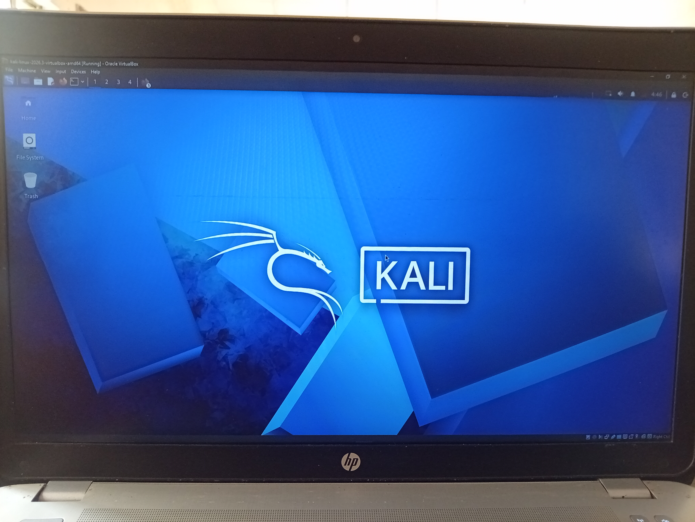
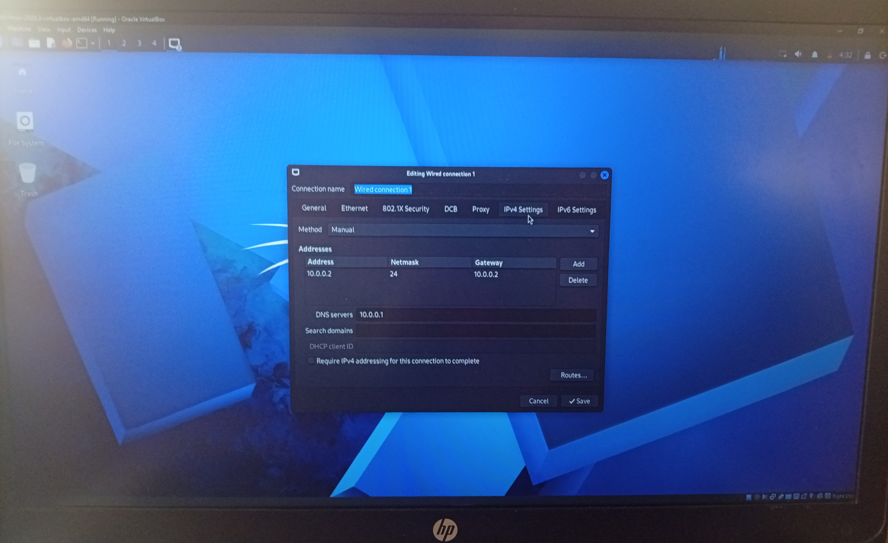

NetworkWalks Cybersecurity Lab: Kali Linux Setup

## 1. Project Overview

This project documents my hands on experience setting up a cybersecurity lab using Kali Linux and Oracle VirtualBox as part of my NetworkWalks learning journey.

The goal was to create a working Linux environment where I can learn cybersecurity tools, practice networking concepts, and build practical technical skills.

This documentation covers the setup process, troubleshooting challenges, network configuration, verification, and lessons learned.

## 2. Project Objectives

- Install and run Kali Linux in a virtual machine.
- Configure hardware virtualization.
- Set up VirtualBox NAT Network connectivity.
- Troubleshoot virtual machine startup and internet connectivity issues.
- Document the process and practical lessons.
- Establish a foundation for future cybersecurity projects.

## 3. Tools and Technologies

- Operating system: Kali Linux
- Virtualization software: Oracle VirtualBox
- Host operating system: Windows
- Virtual networking: VirtualBox NAT Network (10.0.0.0/24)
- Kali Linux IP Address: (10.0.0.2/24)

## 4. Kali Linux Installation

I downloaded the prebuilt Kali Linux VirtualBox image and extracted the downloaded archive.

I then imported the virtual machine into Oracle VirtualBox and attempted to start it.

The initial setup provided an opportunity to understand how virtual machines rely on hardware virtualization support.

## 5. Troubleshooting Hardware Virtualization

The problem

When I first attempted to start Kali Linux, VirtualBox displayed an error indicating that Intel VT-x was disabled in the BIOS.

The solution

I restarted my computer and entered the BIOS settings. I located and enabled the following options:

- Intel Virtualization Technology (VT-x)
- Virtualization Technology for Directed I/O (VT-d)

After saving the changes and restarting the computer, I was able to start the Kali Linux virtual machine.

Lesson learned

Hardware virtualization must be supported and appropriately enabled for many virtual machine configurations to work correctly.

## 6. Network Configuration

I configured the Kali Linux virtual machine to use NAT Network in Oracle VirtualBox.

During the configuration process, I used the IP address "10.0.0.2/24" while working with the network settings in both VirtualBox and Kali Linux.

The initial network setup did not provide the expected internet connectivity, so I continued troubleshooting.

Internet connectivity restored

After further adjustments, I successfully opened a website inside Kali Linux.

This confirmed that the virtual machine could access the internet at that point.

Network configuration notes

- VirtualBox network mode: NAT Network
- IP address used during configuration: "10.0.0.2/24"
- DNS server: 10.0.0.1
- Internet access: Successfully verified by opening a website inside Kali Linux

## 7. Verification Results

The following results were confirmed during the lab setup:

| Test | Result |
| --- | --- |
| Kali Linux virtual machine starts | Successful |
| Intel VT-x enabled in BIOS | Successful |
| NAT Network configured | Successful |
| Website opened inside Kali Linux | Successful |
| Final IP address and subnet verified | Successful |

## 8. Challenges Encountered

Challenge 1: Virtual machine failed to start

Cause: Hardware virtualization was disabled in the BIOS.

Resolution: Enabled Intel VT-x and VT-d in BIOS settings.

Challenge 2: Internet connectivity problems

Cause: The initial network configuration did not provide the expected connectivity.

Resolution: Continued troubleshooting the NAT Network setup until a website loaded successfully inside Kali Linux.

Challenge 3: Understanding virtual networking

The setup highlighted the importance of understanding the difference between an IP address, a subnet, a gateway, and a VirtualBox networking mode.

## 9. Key Lessons Learned

- How to import and start a prebuilt Kali Linux virtual machine.
- How to troubleshoot BIOS virtualization settings.
- How to configure networking for a virtual machine.
- How to verify internet access from within Kali Linux.
- Why technical documentation should distinguish confirmed results from unverified configuration details.
- Why recording errors and their solutions is valuable for cybersecurity learning.

## 10. Future Improvements

As I continue learning, I plan to:

- Run and record additional network connectivity tests.
- Capture screenshots of the working lab environment.
- Explore beginner friendly Kali Linux networking and security tools.
- Document future practical labs and their results.

## 11. Conclusion

Setting up this lab was an important step in my cybersecurity learning journey.

The experience involved more than installing software. I also had to troubleshoot a virtualization problem, work through network connectivity issues, and verify that internet access was working inside Kali Linux.

I will continue improving this repository as I gain more hands on experience with cybersecurity tools and networking concepts.

## Author

# BOLAJI BASIT | NetworkWalks Intern

This repository is a learning portfolio documenting my practical lab work and progress in cybersecurity.
